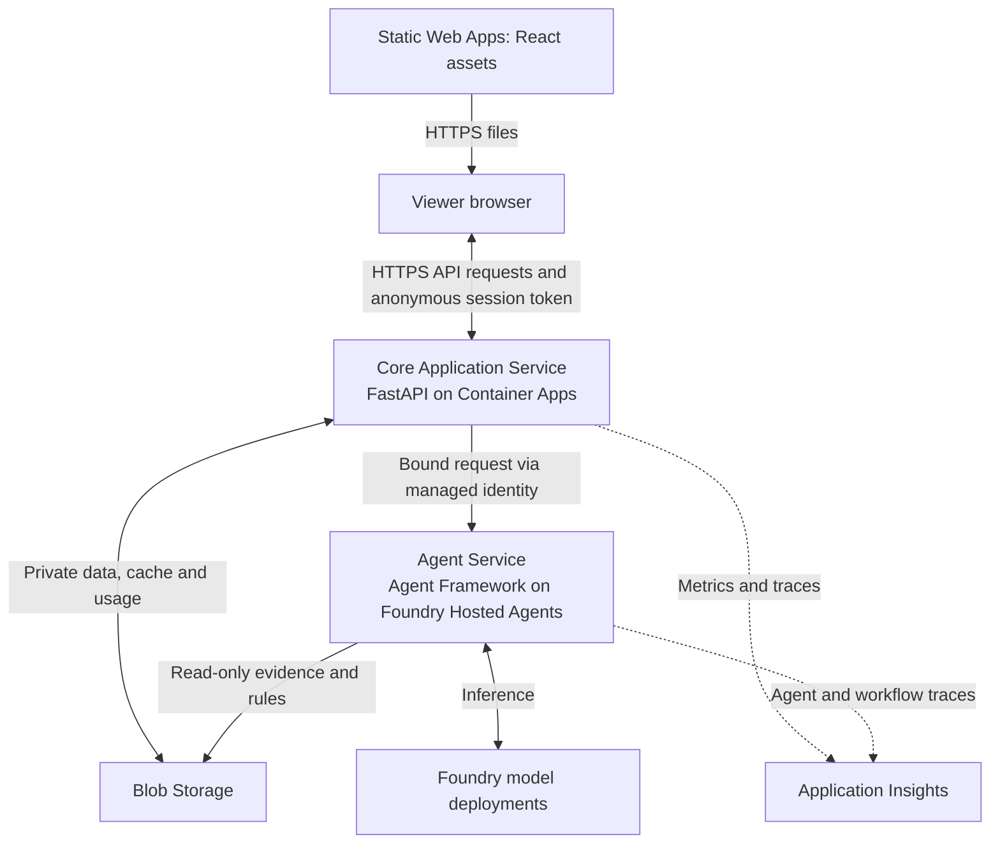
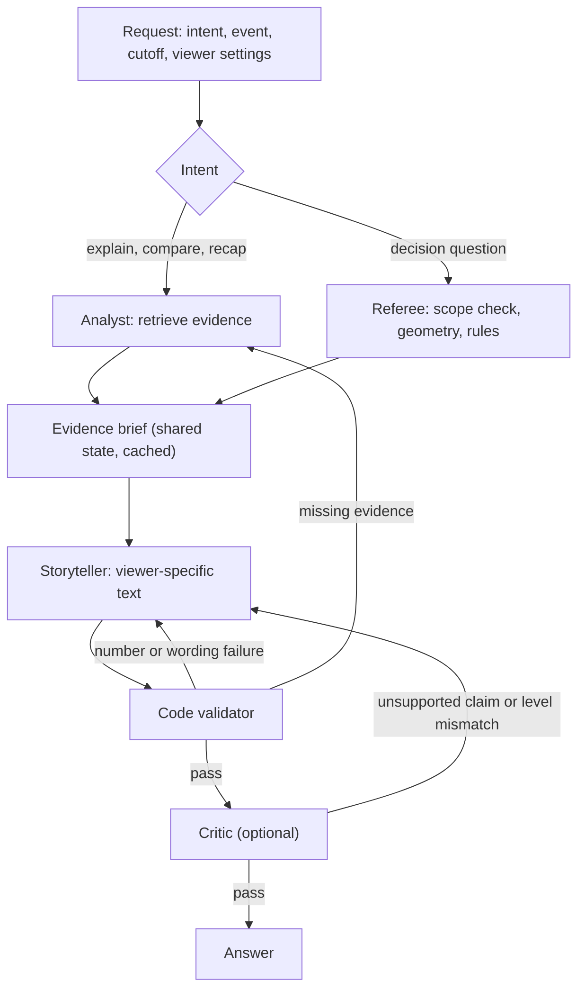

# Football Match Companion — High-Level Design

Version: 1.3  
Date: October 22, 2026  
Status: Proposed implementation design; no application or cloud resources have been deployed  
Basis: Football Match Companion Requirements v0.3, the Inside the Game: Developer Hackathon Official Rules, plus the subsequent Azure, budget, traffic, database, RAG, access and personalization decisions

Changes in 1.2: single agent replaced by a multi-agent workflow (Analyst, Referee, Storyteller, optional Critic) on Microsoft Agent Framework with Foundry agents; Ask the Ref decision questions added; brief cache split from explanation cache.

Changes in 1.3: backend split into independently deployed Core Application and Agent services; the Core runs FastAPI on Container Apps, while the Agent Service runs Microsoft Agent Framework on Foundry Hosted Agents without FastAPI. Shared contracts and deterministic evidence code are packaged into both services.

Changes in 1.1: anonymous judge access replaces Entra sign-in; favorite club, favorite player and player-focus mode added; timed overlay cue contract and automatic narrative cards added; evidence tools implemented as Foundry function tools executed by the backend; hackathon alignment, judging-window operation, compressed build plan and submission checklist added.

## 1. Architecture decision

Build three independently deployed units: a React/TypeScript frontend, a Python/FastAPI Core Application Service, and a Python Agent Service. Host the frontend on Azure Static Web Apps Free, the Core Service on Azure Container Apps Consumption, and the Agent Service as a Microsoft Foundry Hosted Agent deployed from source. The Agent Service uses Microsoft Agent Framework and supported pay-per-token Foundry model deployments.

The Core Service owns the public API, replay/state, statistics, overlays, anonymous sessions, usage limits, cache, and response shaping. The Agent Service owns the Analyst, Referee, Storyteller and optional Critic workflow, function-tool dispatcher, prompts, and AI-output validation. Both deployments consume a shared Python package containing contracts and deterministic evidence logic; neither service imports the other.

Azure Blob Storage is the only application data store in the MVP. There is no application-managed SQL, NoSQL or vector database. The backend creates temporary indexes in memory and reloads them after a restart. Foundry may maintain its own service state; that does not require us to deploy an application database.

Use retrieval-augmented generation (RAG) through structured evidence tools. The tools are declared only to the agents that need them. Each agent decides which functions to call; the Agent Service executes them locally through the shared deterministic package against the Core-supplied bound context and read-only Blob data. No evidence-tool endpoint is exposed publicly. Two synthetic matches and a small approved rules collection do not require embeddings or a vector-search service.

The application is publicly accessible without sign-in. Paid generation is protected by anonymous session tokens, per-session and per-IP limits, a persistent global usage allowance and a pre-warmed cache, not by viewer identity.

### Decisions at a glance

| Area | Selected design |
| --- | --- |
| Frontend | React/TypeScript SPA, Azure Static Web Apps Free |
| Core Application Service | FastAPI container on Azure Container Apps Consumption; independently built and deployed from GHCR |
| Agent Service | One source-deployed Foundry Hosted Agent containing the Microsoft Agent Framework workflow; no FastAPI or customer-managed ACR |
| AI workflow | Four logical agents (Analyst, Referee, Storyteller, optional Critic); a tool-capable model for Analyst/Referee and a smaller model for Storyteller/Critic |
| Agent coordination | Shared evidence brief as workflow state; failures routed back to the responsible agent; factual fallback after one retry |
| Agent tools | Agent Framework function tools, executed inside the Agent Service and scoped per agent; Storyteller and Critic have no tools; no MCP server |
| Decision questions | Ask the Ref: suggested questions per decision plus scope-checked free text, answered by the Referee agent |
| Retrieval | Structured event/statistic/player retrieval and curated rule lookup |
| Durable application storage | Private Azure Blob Storage |
| Temporary processing | In-memory indexes and deterministic calculations |
| Viewer access | Public and anonymous; no sign-in; signed anonymous session token for generation routes |
| User preferences | Browser storage: level, language, favorite club, favorite player, focus mode; no user-profile database |
| Render output | 2D pitch plus a timed, machine-readable overlay cue feed |
| Service scaling | Core: zero to one Container Apps replica; Agent: Foundry per-session scale-to-zero with a short idle timeout |
| Traffic assumption | About 100 AI explanation requests during development/demo, plus judge traffic largely served from cache |
| Budget | USD 20 hard total project ceiling; no credits assumed |
| Target category | To decide: Best Multi-Agent System or Best Use of Microsoft Foundry |
| Video and live feeds | Outside the MVP; the replay is presented as a streamed event feed |

The 100-request figure is a planning assumption, not an automatic shutdown threshold. Replay reads, overlay feeds, evidence navigation and individual model turns can produce additional HTTP requests.

## 2. Scope and design goals

The MVP provides exactly two stored synthetic football-realistic matches, play/pause/seek/restart, an annotated 2D pitch, a timed overlay cue feed, Beginner/Intermediate/Pro explanations, English plus one reviewable second language, favorite club and favorite player preferences, a player-focus mode, automatic narrative cards at detected turning points, similar-event comparisons, Ask the Ref questions on two to three decision types (offside flag including the reversed goal, a tactical-foul yellow card, and a penalty if time allows) and a full-time recap.

Every highlighted moment explains what happened, contributing factors and why it matters. Numerical facts come from deterministic code. Explanations link to recorded events, calculated statistics and applicable rules.

The main goals are:
- Make the match understandable at different knowledge levels and from a viewer's chosen club and player perspective.
- Demonstrate purposeful multi-agent collaboration: agents with distinct roles and tools, a shared evidence brief, routed recovery from failures.
- Explain referee decisions against the Laws using recorded positions, including saying when the data cannot settle a call.
- Preserve the viewer's selected time boundary across replay, retrieval and generation.
- Keep the factual replay usable when AI is unavailable.
- Remain available to judges, without sign-in, through the end of the judging period.
- Support low traffic without maintaining an always-running application server outside the judging window.

Excluded from this release: video analysis, real broadcasts, continuous player tracking, measured player or ball speed, a real historical archive, durable chat history, viewer accounts, subscriptions, a vector database and referee questions on decision types without authored data.

### Personalization

The same factual intelligence produces different experiences through four viewer settings, all stored in the browser and sent with each request:

| Setting | Effect |
| --- | --- |
| Level | Beginner, Intermediate or Pro: vocabulary, depth and which statistics are shown |
| Language | English or the selected second language for all generated text and UI labels |
| Favorite club | Orders and frames narrative from that club's perspective; highlights its overlay cues. It never changes facts, statistics or rule interpretations |
| Favorite player / focus mode | Adds a player panel with that player's deterministic statistics, prioritizes cues and narrative cards involving the player, and draws a persistent marker wherever supplied positions exist |

Personalization changes selection, ordering, emphasis and wording. It must not introduce claims about a player's involvement that the evidence does not show. When the focus player is absent from a moment, the explanation says so rather than inventing a connection.

### Hackathon alignment

Key dates from the Official Rules: registration closed October 20, 2026 at 12:00 pm PT; submissions close October 27, 2026 at 11:59 pm PT; judging runs October 27 to November 10, 2026. Registration must be confirmed before any further work.

| Challenge stage | Design element |
| --- | --- |
| Ingest | Stored synthetic matches delivered as a time-ordered event feed with availability times (Section 6) |
| Interpret | Deterministic team and player statistics, activity windows and turning-point detectors (Section 6) |
| Explain | Evidence-grounded multi-agent explanations with validation, and Ask the Ref decision answers (Sections 7 and 8) |
| Render | 2D pitch annotations and the timed overlay cue contract (Section 6) |
| Personalize | Level, language, favorite club, favorite player and focus mode (Section 2) |
| Narratives and recaps | Automatic narrative cards and the full-time recap (Section 6) |
| Data innovation | Versioned synthetic dataset generator and validator (Section 5) |
| Multi-language | Second reviewed language across UI and generated text |

| Judging criterion (20% each) | How the design addresses it |
| --- | --- |
| Technological Implementation | Foundry agents in a Microsoft Agent Framework workflow with function tools, Container Apps, managed identity, tested deterministic core, synthetic data generator |
| Agentic Design & Innovation | Four agents with distinct roles and least-privilege tools, a shared evidence brief, failures routed to the responsible agent, time-bounded tool context the models cannot widen. The split makes facts identical across viewer perspectives by construction and lets one Analyst run serve every viewer variant |
| Real-World Impact | Overlay contract usable by a rendering partner; factual fallback; cost and usage controls |
| User Experience & Presentation | Replay UI, personalization, evidence navigation, under-two-minute demo video |
| Adherence to Category | Best Multi-Agent System: distinct roles, shared state, handoffs, recovery. Best Use of Microsoft Foundry: agents, tracing and evaluations in Foundry |

## 3. Deployment and trust boundaries

The browser downloads static files from Static Web Apps and calls the Container Apps API URL directly. This is not the paid Static Web Apps backend-proxy integration. Restrict browser cross-origin access to the deployed frontend origins and protect API routes independently.



All viewer routes are anonymous. Generation routes require a signed anonymous session token issued by the API, and are bounded by per-session, per-IP and global limits. Access controls are described in Section 10.

The Core invokes the Agent Service through the Foundry endpoint using managed identity; browser identities cannot invoke it. The request is a versioned shared contract containing the immutable match, cutoff, dataset, rules and viewer context. Analyst and Referee tool calls execute inside the Agent Service against that bound context. The Agent Service cannot widen the cutoff supplied by the Core, and it receives read-only access to datasets and rules. [R1]

Static Web Apps' linked external-backend integration requires Standard and has a 45-second API request limit. This design uses direct browser-to-API calls instead. [R2]

## 4. Component responsibilities

| Component | Responsibilities | Does not own |
| --- | --- | --- |
| Browser application | Replay controls, local playback clock, pitch drawing, overlay rendering, timeline, personalization preferences, explanations and evidence navigation | Azure service keys, authoritative statistics or unrestricted model calls |
| Core Application Service | FastAPI boundary, input validation, anonymous sessions, request IDs, context binding, rate/concurrency/budget limits, caches and response shaping | Prompts, model orchestration or model-generated match facts |
| Agent Service | Foundry protocol host, Microsoft Agent Framework workflow, prompts, tool dispatch, structured generation and validation | Public viewer routes, sessions, billing allowance or cache ownership |
| Shared backend package | Versioned service contracts, deterministic domain calculations, evidence retrieval and validation primitives packaged into both services | Network calls, deployment configuration or mutable state |
| Replay/state engine | Reconstruct score, cards, possession and available events at a requested cutoff; apply corrections in order | Future-event access for earlier contexts |
| Analytics engine | Team and player statistics, pass distance, window comparisons and turning-point candidates | Language generation |
| Overlay engine | Timed, machine-readable cues derived from events, statistics and detectors | Generated prose |
| Retrieval module | Event sequences, snapshots, player summaries, comparable moments and approved rule excerpts | Arbitrary web browsing or real-world history |
| Tool dispatcher | Maps Foundry function calls to retrieval functions; validates names and arguments; binds the request context; enforces cutoff and tool-call limits | Viewer-facing API routes |
| Agent workflow | Microsoft Agent Framework graph: routing by intent, shared evidence brief, handoffs, failure routing and retry bounds | Facts or statistics |
| Analyst agent | Retrieve evidence and produce a neutral English evidence brief | Viewer wording, rule interpretation |
| Referee agent | Scope-check decision questions; retrieve decision evidence, geometry and rules; produce a ruling brief | General match analysis |
| Storyteller agent | Turn a brief into level-, language-, perspective- and focus-player-specific output; no tools | New facts |
| Critic agent (optional) | Check that causal claims follow from the brief and the text fits the level; no tools | Numeric checks, which are code |
| Foundry host adapter | `ResponsesHostServer`, Foundry model client, bounded function-calling loop and structured output | FastAPI or public application routes |
| Evidence validator | Reference, time, rule-version, player-involvement and numerical checks; one bounded repair attempt | Proof that every qualitative causal interpretation is true |
| Blob repository | Versioned datasets/rules, brief and explanation caches, narrative cards, suggested questions and small operational records | Relational queries or application user profiles |
| Observability | Request/agent traces, latency, token usage, cache hits, failures and validation results | Secrets or unrestricted personal conversation logs |

The Core and Agent services are separate deployment artifacts with independent release versions. Their only application-level coupling is the versioned shared contract. A contract compatibility test must pass before either deployment is promoted.

## 5. Data architecture — Blob Storage only

Use one Standard storage account with private blob containers and an economical redundancy setting appropriate to a reproducible demo. The final region and redundancy are deployment choices.

| Data group | Contents | Access pattern |
| --- | --- | --- |
| Match manifests | Exactly two match IDs, fictional teams/players, squads, chronology, rule edition, dataset version and file references | Small read on startup or match selection |
| Match events | Ordered event records, possession references, outcomes, coordinates and availability times | Load into memory; index by match/time/event/player ID |
| Position snapshots | Supplied player/ball coordinates at selected timestamps | Retrieve only snapshots available at the cutoff |
| Rule collection | Short curated excerpts or paraphrases for Laws 11, 12 and (if used) 14, incident tags, edition, rule identifier and source URL | Lookup by supported incident type and edition |
| Suggested questions | Per decision type, stable question IDs and localized question text | Read with the decision |
| Brief cache | Validated evidence and ruling briefs, independent of viewer settings | Read/write by evidence key |
| Explanation cache | Validated structured explanations and referee answers, evidence IDs and context/version metadata | Read/write by deterministic cache key |
| Narrative cards | Pre-generated, validated cards for detected turning points, per level/language/club perspective | Read by match, availability time and viewer settings |
| Operational records | Idempotency status, model-usage reservations, usage totals and session/IP counters | Small conditional writes at this request volume |

Keep expected evaluation answers in test fixtures outside the agent-accessible data collection. Treat source match files as immutable versions. Publish a new manifest when data changes rather than modifying an active match in place.

The repository is public. Rule excerpts must be short and attributed, or paraphrased with a link to the authoritative source; check the rule publisher's terms before publishing quoted text. All clubs, players and venues are fictional, and no Premier League marks appear in data, UI or video.

### Conceptual records

- **Match:** identity, synthetic label, chronology, teams, squads, periods, direction of attack and version.
- **Event:** stable identity, sequence, period/time, availability time, type, outcome, entities, coordinates and related events.
- **Snapshot:** identity, time, supplied entity positions and source references.
- **Statistic:** metric definition/version, team or player, window, value and supporting event IDs.
- **Annotation:** identity, geometry/type, source IDs and visibility interval.
- **Overlay cue:** identity, start/end match time, cue type, subject team/player, payload, priority and evidence IDs.
- **Narrative card:** identity, trigger, availability time, viewer-setting variant, text sections and evidence links.
- **Rule reference:** incident category, edition, rule identifier, excerpt or paraphrase and authoritative link.
- **Explanation:** request context, factual/interpretive claims, significance, uncertainty and evidence links.

On cold start, the backend loads the current manifest and builds bounded in-memory indexes. It must be able to reconstruct state using Blob Storage alone. Local disk and process memory are disposable.

At this volume, a small operational JSON blob can hold generation reservations, usage totals and limit counters. Use ETag-based conditional updates and bounded conflict retries; never use unprotected last-writer-wins updates for shared counters. With one replica, ETags mainly protect against overlapping revisions and restarts. A crashed or uncertain model call retains its reservation until reconciled. Reconciliation runs on startup and on a timer: a reservation older than the configured maximum run time is charged at its full reserved amount and closed, so stuck reservations cannot silently consume or release allowance. Blob Storage supports this concurrency pattern. [R3]

This is deliberately a small-volume design. Sustained concurrent writes, durable chat/user histories or a much larger archive would justify a database later.

## 6. Replay, statistics, overlay and narrative flow

### Replay flow

1. The browser loads the two-match catalog without final scores or future incident summaries.
2. Selecting a match requests a state snapshot, overlay cues and events available up to the selected replay time.
3. The browser advances its local clock and requests event and cue deltas in batches. Animation frames do not trigger model calls.
4. The backend validates the requested time and returns only records available at that cutoff, plus verified state/statistics and applicable annotations.
5. A seek rebuilds state from a checkpoint plus subsequent events, or from the event log when simpler. Both approaches must produce the same result.
6. A restart, match switch or seek invalidates old pending contexts and visible annotations.

Replay event batches are separate from the estimated 100 explanation requests. Their frequency and size will be tuned during implementation. Do not deliver the full unfiltered match file to the UI as a shortcut for cutoff enforcement.

The cutoff is supplied by the client, so the time boundary is a correctness property for UI state and AI context, not an access control. Any caller can request a later cutoff on public synthetic data; that is acceptable.

The viewer may intentionally seek forward. The time boundary means that an answer cannot use information beyond the selected time; it does not prohibit forward seeking. Each AI request captures an immutable context with match, event, cutoff, dataset version, level, language, favorite club, focus player and intent.

A delayed answer may appear as a clearly timestamped historical card if that context is still valid. It must not overwrite the current score or be presented as analysis of a different time. Seek, match and preference changes invalidate incompatible responses.

### Analytics

The detailed definitions remain in Requirements Section 6. The implementation uses these same conventions:

| Metric or detector | MVP behavior |
| --- | --- |
| Pass completion | Completed valid passes / attempts; no attempts returns N/A |
| Pass distance | Euclidean distance between recorded start and end coordinates, in metres on the normalized pitch |
| Shots / shots on target | Count the defined controlled outcomes; apply nullifications only once their decisions are available |
| Final-third entries | Successful pass/carry crossings into the attacking third, using normalized attacking direction |
| Player statistics | Per player: touches, passes, pass completion, average pass distance, shots, shots on target, final-third entries, recoveries |
| Activity windows | Latest five minutes versus preceding five minutes within the same period; require both complete windows, so no window comparison exists in the first ten minutes of a period |
| State-change candidates | Goals, goal reversals and red cards |
| Activity candidates | At 30-second checkpoints, fire when all three hold for one team: at least two more shots than in the preceding window, at least three more final-third entries than in the preceding window, and at least one shot on target in the latest window; five-minute cooldown per team |

These are transparent project heuristics, not a win-probability model. The detector records why it fired and the evidence used. The agents explain the result without calculating replacement statistics. Thresholds are versioned and checked against the generated matches to confirm the detector fires at least once per match.

### Annotations

The renderer draws pass/carry arrows, shot paths, recovery markers, third boundaries, the focus-player marker and supported referee geometry from event/snapshot coordinates. All shapes retain source IDs.

Only supplied positions are shown. Missing data remains unavailable. Any interpolated motion is schematic and cannot support claims about measured speed, spacing or tactical intent.

### Overlay cue contract

The overlay engine emits timed, machine-readable cues so the same insight could be rendered by a broadcast graphics partner, not only by this UI. The browser renders cues over the pitch; `GET /api/matches/{id}/overlays` serves the same feed.

Each cue contains: cue ID, schema version, match ID, start and end match time, cue type, subject team and/or player, a typed payload, display priority, personalization tags and evidence IDs. Initial cue types are score bug updates, goal and card banners, stat comparison bars, turning-point alerts, player tags for the focus player and narrative-card pointers.

Cues are deterministic. Generated text appears only inside narrative-card cues that reference an already-validated card. The schema is versioned and published in the repository.

### Automatic narrative cards

When a state-change or activity detector fires, a narrative card becomes available at the event's availability time without the viewer clicking anything. Cards for the two stored matches are generated ahead of time, produced by the same multi-agent workflow and validated with the same checks as on-demand explanations, and stored in Blob Storage for the demo variants: three levels, two languages and neutral or each club's perspective. Uncached variants fall back to a factual template card.

Cards are an automatic narrative layer, not a separate live model call per event. This keeps live replay responsive and puts their cost inside the planned evaluation budget.

## 7. RAG and multi-agent design

RAG means retrieving evidence and using it to ground generation. In this system, retrieval is structured and performed through tools. Blob Storage persists the source files; the backend's indexes and calculation functions perform the retrieval, and the tool dispatcher executes them when an agent requests a function call.

The work is split along one line: deciding what is true, and deciding how to say it to this viewer. Agents that retrieve evidence never write viewer-facing text; the agent that writes viewer-facing text cannot retrieve anything.

### Agents

| Agent | Role | Tools | Output |
| --- | --- | --- | --- |
| Analyst | Find out what happened, contributing factors and significance, neutrally and in English | get_match_state, get_event_evidence, get_match_statistics, get_player_summary, find_similar_events | Evidence brief |
| Referee | Scope-check decision questions and explain how the Laws apply to a recorded decision | get_event_evidence, get_decision_geometry, get_rule_reference, get_match_state | Ruling brief |
| Storyteller | Write the answer for this viewer's level, language, club perspective and focus player | None | Explanation or referee answer |
| Critic (optional) | Check that causal claims follow from the brief and the text fits the level | None | Pass, or a routed failure |

The deterministic evidence validator, overlays, statistics and detectors stay as code. The Critic is built last and can be dropped without changing the other agents.

### Workflow



Each failure route is taken at most once per request. A second failure returns the factual fallback. The workflow runs inside the independently deployed Foundry Agent Service using Microsoft Agent Framework. Analyst, Referee, Storyteller and Critic are logical roles with separate instructions, tool sets and limits inside that service. The Core sees only the versioned `AgentRequest` and `AgentResponse` contract.

### Evidence brief

The brief is the shared state between agents. It contains facts with evidence IDs, statistics by stat reference, candidate contributing factors, a significance statement or the reason it cannot be established, uncertainty notes, an optional comparison and, from the Referee, an optional ruling. It is written in English and contains no viewer settings.

Because the brief excludes viewer settings, one Analyst or Referee run serves every level, language, club perspective and focus-player variant; only the Storyteller step repeats. This makes facts identical across perspectives by construction and reduces the number of tool-using runs needed for narrative cards and cache pre-warming.

### Retrieval tools

| Tool | Retrieved evidence | Used by |
| --- | --- | --- |
| get_match_state | Verified score, period, clock, cards and relevant state | Analyst, Referee |
| get_event_evidence | Selected action, build-up sequence and available snapshots | Analyst, Referee |
| get_match_statistics | Deterministic team values, definitions, windows and evidence IDs | Analyst |
| get_player_summary | A player's deterministic statistics and involvement in events up to the cutoff | Analyst |
| find_similar_events | Eligible comparisons from the two stored matches with similarities and differences | Analyst |
| get_decision_geometry | Deterministic geometry for a recorded decision: offside line, attacker margin, involvement; or foul location and attack context | Referee |
| get_rule_reference | Approved rule paraphrase, edition, identifier and source | Referee |

The dispatcher takes match, cutoff and dataset version from the bound request context, not from model-supplied arguments. Function schemas do not expose those fields at all, so no agent can widen its own time boundary. Each agent's tool allowlist is enforced by the dispatcher, not only by its instructions.

Similar-event retrieval uses event type, normalized location, possession shape, decision category and relevant timing. Rule retrieval uses incident tags and the applicable edition. Matching thresholds are versioned and tested against positive and no-match examples.

Same-match comparisons must precede the current cutoff. Cross-match archive access follows the matches' chronology; the later-dated match is unavailable as historical context while replaying the earlier one.

No embedding model, vector store, Azure AI Search instance or MCP server is required in the MVP. A larger text/rule collection could later add semantic or hybrid retrieval behind the same tool contracts.

### Ask the Ref

Viewers can ask how the Laws apply to a recorded decision: why a flag was raised, why a card was shown, what would have made a player onside. The feature explains decisions; it does not defend them.

Scope for the MVP is two to three decision types, each with authored snapshots and rule paraphrases:

| Decision | Law | Evidence |
| --- | --- | --- |
| Offside flag, including the reversed goal | Law 11 | Snapshot at the moment of the pass; second-last defender line; attacker margin; involvement in play |
| Tactical-foul yellow card | Law 12 | Foul event, qualifiers, snapshot showing the attack stopped |
| Penalty (if time allows) | Laws 12 and 14 | Foul inside the area, snapshot |

Every answer has three parts: what the decision was; which Law applies and what it requires; and whether the recorded data supports the decision, contradicts it, or cannot settle it. One authored borderline call, such as an offside margin within measurement uncertainty, demonstrates the third case.

Questions come in two forms:
- **Suggested questions:** three or four per decision type with stable question IDs, pre-generated for the demo across levels and languages, and cached.
- **Free text:** up to 300 characters. The Referee first classifies scope: this decision (answer), another visible decision (redirect), a general Laws question (answer from the rule collection without match claims), or out of scope or about future events (template refusal). The question is treated as data and cannot change tools, cutoff or instructions. Follow-ups send the last two question-and-answer pairs; the context stays bound to the same decision and cutoff.

The pitch overlay draws the decision geometry, such as the offside line with the margin labeled, from `get_decision_geometry`. For a viewer whose club was penalized, the Storyteller may acknowledge the frustration but states the same facts.

### Personalization in the Storyteller

The Storyteller receives the brief plus level, language, favorite club and focus player. Instructions require it to use only facts in the brief, use club perspective only for framing and emphasis, mention the focus player only where the brief shows involvement, and state explicitly when the focus player was not involved.

### Model and SDK boundary

Use a Foundry project client and its OpenAI-compatible Responses client, with Azure identity authentication. Agent definitions and model deployments live in Foundry; Microsoft Agent Framework and the Foundry SDK are dependencies in the existing backend. Use a tool-capable model for the Analyst and Referee, and a smaller model for the Storyteller and Critic if evaluation confirms quality. Pin the tested framework, SDK and model versions before release. Use Foundry tracing and Foundry evaluations for the evaluation set. [R4]

Use request-scoped agent context. Do not reuse an unconstrained conversation containing later events after a seek backwards. Delete or expire any service-side conversation state after each request if the selected agent API persists it. Persistent conversational memory is outside the MVP.

## 8. Explanation request sequence

```mermaid
sequenceDiagram
    participant UI as Browser
    participant API as FastAPI and workflow
    participant Blob as Blob Storage
    participant Ana as Analyst or Referee
    participant Tools as Backend tools
    participant Sto as Storyteller
    UI->>API: Explain event or ask the Ref, with cutoff and viewer settings
    API->>API: Check session token, limits and context
    API->>Blob: Read explanation cache
    alt Explanation cache hit
        Blob-->>API: Validated answer
        API-->>UI: Answer and evidence
    else Explanation cache miss
        API->>Blob: Reserve usage and request identity
        API->>Blob: Read brief cache
        alt Brief cache miss
            API->>Ana: Context and question
            loop Bounded evidence requests
                Ana-->>API: Requested function and arguments
                API->>Tools: Execute within bound context and agent allowlist
                Tools-->>API: Structured evidence and references
                API->>Ana: Tool result
            end
            Ana-->>API: Brief
            API->>Blob: Save validated brief
        end
        API->>Sto: Brief and viewer settings
        Sto-->>API: Viewer-specific answer
        API->>API: Validate; route one failure back; optional Critic
        API->>Blob: Save valid answer and reconcile usage
        API-->>UI: Answer or factual fallback
    end
```

Backend tools in the sequence are in-process modules, not another hosted service.

### Answer contract and checks

Explanations return what happened, contributing factors, why it matters, uncertainty and any supported comparison/rule section. Referee answers return the decision, the applicable Law, what the data shows (supports, contradicts or cannot settle) and uncertainty. Both attach the exact match/event/cutoff, viewer settings, evidence references and a request ID.

Before display, verify:
- Every referenced event, snapshot, statistic, player and rule exists in the permitted evidence set.
- Numerical and geometric claims agree with backend values and units.
- Rule citations use the scenario's pinned edition.
- A referee answer states the recorded decision exactly as recorded.
- No fact or comparison exceeds the allowed time boundary.
- Any claim about the focus player is backed by an event involving that player.
- The output includes significance or explicitly states why significance cannot be established.

Automatic checks cannot fully validate causal reasoning or translation quality. The optional Critic and human review remain part of evaluation.

### Cache and request control

There are two caches. The brief cache key includes dataset version, match, selected event/intent, evidence cutoff, rule collection version, Analyst/Referee model deployments and prompt/tool-schema versions, and for referee questions the question ID or normalized question hash. The explanation cache key adds level, language, club perspective, focus player and the Storyteller model and prompt versions. The evidence cutoff is the availability time of the latest event visible at the viewer's cutoff, not the raw replay time. Club perspective and focus player are included only when they apply to the selected event; otherwise they are normalized to neutral and none. A future-time answer cannot satisfy an earlier-time request.

Before submission, pre-warm both caches with validated answers for the demo moments and suggested referee questions across all levels, both languages and the demo viewer profiles. These answers survive scale-to-zero and serve judges instantly.

Cache only validated outputs. Free-text referee questions are answered but not stored in the shared cache in the MVP, so one viewer's question is never served to another; their text goes only to traces with limited retention.

Use idempotency keys for explanation and question requests. Duplicate clicks should reuse an existing result or report an in-progress request, rather than silently starting another generation. A timed-out request with an uncertain provider outcome is not automatically replayed.

Allow at most six tool executions per tool-using agent run, one routed retry and one optional Critic pass per request, within configured model-turn, token and wall-clock limits across the whole workflow. The dispatcher counts tool executions per request and returns a limit-reached result beyond the bound. Final numeric limits are set after the first measured runs.

## 9. API surface

These are proposed contracts for the low-level design, not implemented endpoints.

| Endpoint | Purpose | Access |
| --- | --- | --- |
| GET /api/matches | Two-match catalog and safe metadata, including squads for player selection | Public |
| GET /api/matches/{id}/replay | State, event deltas, team/player statistics and annotations up to cutoff | Public, bounded requests |
| GET /api/matches/{id}/overlays | Timed overlay cues up to cutoff, filtered by viewer settings | Public, bounded requests |
| GET /api/matches/{id}/narratives | Narrative cards available up to cutoff for the viewer settings | Public, bounded requests |
| GET /api/matches/{id}/evidence/{evidenceId} | Resolve evidence within a supplied valid context | Public synthetic data, cutoff checked |
| POST /api/sessions | Issue a short-lived anonymous session token | Public, rate-limited per IP |
| POST /api/explanations | Explain, compare or interpret a supported decision | Anonymous session token, limited |
| POST /api/recaps | Generate a recap from verified state; full-match recap only at full time | Anonymous session token, limited |
| GET /api/matches/{id}/decisions | Decisions visible at the cutoff, with geometry and suggested questions | Public, bounded requests |
| POST /api/referee/questions | Ask the Ref: a suggested question ID or free text about a visible decision | Anonymous session token, limited |
| GET /health/live and /health/ready | Process health and readiness | Minimal information only |

Every data response identifies the dataset version and cutoff. Writes to source datasets and operational administration are not public application APIs.

## 10. Security and access

### Viewer access

The Official Rules require the working project to be available to judges free of charge and without restriction through the end of the judging period. The application therefore has no sign-in. Factual replay, overlays, narrative cards and cached explanations are fully public.

Uncached generation is protected without identity:
- `POST /api/sessions` issues a signed, short-lived anonymous session token. The signing key is held as a Container Apps secret.
- Generation routes require a valid session token and enforce per-session and per-IP limits.
- A persistent global usage allowance, sized to include the judging window, caps total model spend.
- When the allowance is reached, new generation stops but cached explanations, narrative cards and factual replay remain available, so judges still see the full experience.

These controls bound cost and casual abuse. They are not strong identity; a determined caller can obtain new sessions, which the per-IP and global limits contain. Microsoft Entra ID sign-in can be added later behind the same routes if the product needs viewer accounts. Local preferences remain in the browser; no user-profile or password database is added.

### Workload identity

Assign the backend a managed identity with:
- Read access to the match and rule containers.
- Write access only to cache, narrative and operational containers.
- The narrow Foundry project/model permissions needed at runtime.
- Container-image pull permission when a private registry is used.

Deployment identities manage infrastructure and agent versions; the runtime identity does not need subscription-wide administration. Model and storage credentials must not appear in React assets or the public repository. Managed identities support scoped access without application-managed Azure keys. [R6]

### Application controls

- Require HTTPS and restrict CORS to known frontend origins.
- Validate IDs, time ranges, viewer levels, languages, club and player IDs and request sizes.
- Enforce per-session, per-IP and global generation limits.
- Derive tool cutoff and match from the bound request context, never from function arguments.
- Allowlist tool names and parameters; tools cannot fetch arbitrary URLs or execute model-provided code.
- Treat retrieved text as evidence, not as instructions that can change permissions.
- Avoid secrets, tokens and unnecessary personal data such as raw IP addresses in logs; store hashed IPs for limits.
- Render generated content safely rather than injecting arbitrary HTML.

A full API gateway, WAF and private-network topology are not part of this small demo. Revisit them if public exposure, data sensitivity or traffic changes.

## 11. Deployment and on-demand operation

### Resource inventory

| Resource | Initial configuration |
| --- | --- |
| Resource group | One project group with consistent ownership and cost tags |
| Static Web App | Free plan, static React build |
| Container Apps environment | Consumption workload; standard HTTP ingress |
| Backend container app | Minimum 0 / maximum 1 replica, single active revision; initial 0.5 vCPU / 1 GiB subject to measurement; session signing key as a secret |
| Container image | Public image on GitHub Container Registry to avoid a standing registry charge; Azure Container Registry only if a private image is required |
| Storage account | Blob containers for immutable data, cache, narrative cards and operational records |
| Foundry resource/project | Four agents (Analyst, Referee, Storyteller, Critic); one tool-capable and one smaller Standard pay-per-token model deployment; tracing and evaluations |
| Identity configuration | Backend managed identity only; no viewer app registration |
| Monitoring | Application Insights/Log Analytics with controlled retention and a daily ingestion cap |

Use a compatible region for the backend, storage and available model deployment where practical. Region selection is driven by model availability, quota and credit coverage.

### Startup and shutdown behavior

A request can activate the backend from zero replicas. Startup loads the versioned data and initializes clients/indexes; readiness becomes healthy when factual requests can be served. Foundry availability must not be a condition for serving factual replay.

After inactivity, the backend can scale to zero. No process-local clock, queue, user session or cache is required to survive that shutdown. Storage and platform resources remain provisioned.

The first request after inactivity can be slower. Show a loading state and provide a bounded retry for safe reads. Scaling to zero removes replica compute charges, not storage, registry or every associated charge. [R7]

### Judging-window operation

Judging runs from October 27 to November 10, 2026, and judges may test at any time. Before submission, measure the idle cost of one minimum replica. If it fits the budget, set the minimum to one for the full judging window so no judge hits a cold start; otherwise keep scale-to-zero and make the loading state explicit. Do not deploy breaking changes during judging; the submitted revision must keep functioning as shown in the video.

Use synchronous, bounded explanation requests for the MVP. Do not start important background work after returning an HTTP response and assume it will survive scale-down. If longer-running jobs become necessary, introduce a durable queue/worker as a separate design change.

### Delivery process

Use one public repository with frontend, backend, data-generation/validation and deployment folders, an open-source license, a README with architecture, Microsoft technologies used and testing instructions, and the overlay cue schema. Scan for secrets before making it public.

Build the static frontend and container image in CI, run the relevant checks, then deploy versioned artifacts. Keep infrastructure configuration reproducible and record the agent/prompt/model versions.

Publish immutable dataset versions before switching the active manifest. Backend and frontend responses must reject incompatible dataset/schema versions. Retain a known-good application revision and manifest for rollback.

No deployment, repository creation or subscription changes are performed by this document.

## 12. Reliability, observability and cost

| Condition | Expected behavior |
| --- | --- |
| Foundry timeout, quota or transient failure | Show recorded facts, evidence and any cached card; offer an explicit retry |
| Invalid generated references or numbers | Route once to the Storyteller (wording, numbers) or the Analyst (missing evidence) within the remaining budget; otherwise factual fallback |
| Critic rejects an answer | Route once to the Storyteller; if still rejected, return the validated answer flagged for review in traces, or the factual fallback if the Critic found an unsupported claim |
| Out-of-scope referee question | Template refusal that names what the feature can answer; no tool calls |
| Decision data cannot settle the call | Say so explicitly; state the recorded decision and the margin or missing evidence |
| Missing spatial evidence | Omit unsupported geometry and explain what is unavailable |
| Focus player not involved | Say so; do not invent involvement |
| No comparable incident | Return no close match |
| Model request still running after a seek | Ignore incompatible output; preserve only correctly scoped cache entries |
| Storage unavailable | Use already loaded immutable data where safe; disable new paid generation if allowance/idempotency state cannot be checked |
| Restart during generation | Reconcile the persistent request reservation; avoid blind duplicate model calls |
| Unknown function or invalid arguments | Return a tool error to the agent; count it against the tool limit; fall back to facts if the loop cannot complete |
| Too many simultaneous generations | Bound the waiting work and return a clear busy response |
| Usage allowance exhausted | Keep factual replay, overlays, narrative cards and cached answers available; stop new generation |

Cache-write failure need not hide an otherwise validated answer, but usage reservation/reconciliation must remain conservative and observable.

Measure request latency, cold-start behavior, model/tool calls, token usage, cache hits, evidence-validation failures and factual fallbacks. Record a correlation ID across API, workflow, agent, tool and Foundry traces, with one span per agent step and handoff. Report warm and cold performance separately.

The multi-agent workflow makes two to three sequential model calls on an uncached request, so the warm target is 10–14 seconds for uncached answers; cached and pre-generated answers are unaffected. These are unproven targets for a warm, single-viewer workload. It is not a cold-start guarantee or production SLA.

### Budget assumptions

- User ceiling: USD 20 total for the entire project, including development, evaluation, deployment and the judging window to November 10, 2026. Spending must remain below this amount; no credits are assumed.
- Provisional allocation: USD 6 for hosting, storage and monitoring; USD 10 for all Foundry inference, hosted-agent compute, evaluation and pre-generation; USD 4 contingency. Replace these estimates with measured lower limits, never with a combined allocation above USD 20.
- Planned workload: approximately 100 explanation requests, counted as workflow runs; one Analyst or Referee run per moment or suggested question is reused across viewer variants, and only the cheaper Storyteller step repeats. All model turns, retries, automatic commentary and evaluation runs count toward measured usage.
- Separate budget lines: evaluation and narrative-card pre-generation, cache pre-warming, judge-triggered uncached generation, and judging-window hosting (including one minimum replica if chosen).
- Foundry Agent Service charges beyond model tokens must be checked against the current pricing page.
- Credits: available balance, expiry, eligible services and model quota remain to be checked.

Use Azure Cost Management alerts plus application token/request limits. Budget alerts do not automatically stop resource consumption and can be delayed. Track cumulative project spend across calendar-month boundaries; do not treat USD 20 as a fresh monthly allowance. At USD 15 cumulative spend, disable free-text generation. At USD 18, disable all uncached model calls and minimize compute. At USD 19.50, remove paid model deployments and nonessential billable resources. [R8]

Before generation, reserve a bounded allowance using the configured model limits and applicable rate card. Reconcile returned token usage afterwards. This application control covers model usage; it is not a hard cap on the entire Azure bill.

Cache repeated event/level/language/perspective explanations and use factual templates for routine events. Evaluate actual cost after ten representative requests, counting all internal model turns. Do not add dedicated GPUs, reserved model capacity or a separate database for this workload.

## 13. Verification and build order

| Gate | Evidence required |
| --- | --- |
| Deterministic data | Both matches reproduce the expected score, team and player statistics and decision corrections |
| Temporal correctness | Seeking before a goal removes it from state, overlays, retrieval, annotations and generated context |
| Annotation and overlay integrity | Every shape and cue resolves to supplied event/snapshot data; cue feed validates against the published schema |
| Actual RAG | Trace shows agent-selected function calls, returned records and a grounded explanation |
| Multi-agent behavior | Trace shows Analyst or Referee, brief handoff, Storyteller and validator steps; a forced failure is routed to the responsible agent and recovers; dispatcher rejects a tool outside an agent's allowlist |
| Ask the Ref | Suggested questions answered for each decision type; borderline call reported as not settled by the data; out-of-scope and prompt-injection questions refused; stated decision always matches the record |
| Personalization | Same moment produces different but factually identical output for each level, language, club perspective and focus player; no invented player involvement |
| Explanation quality | Five moments × three levels × two languages, plus about 12 referee cases; factual and qualitative review in Foundry evaluations |
| Failure handling | Timeout, no-match, missing data, stale response, duplicate request, invalid function arguments and usage-limit cases |
| Security | Generation routes reject missing or expired session tokens; limits enforced; runtime identity has limited access |
| On-demand deployment | Restart/scale-to-zero loses no required state; cold and warm paths are measured |
| Cost | All deployed resources inventoried; measured per-explanation usage, judging-window cost and cumulative spend reviewed |
| Judge access | Deployed link works anonymously from a fresh browser, including after the allowance is exhausted |

### Build plan to the October 27 deadline

1. October 21: confirm hackathon registration, Azure credit, Foundry model access and function-calling support for the chosen model. Confirm Microsoft Agent Framework works with the Foundry project, or fall back to a hand-written workflow. Generate and validate the two synthetic datasets with squads, decision snapshots (including one borderline offside) and rule paraphrases.
2. October 22: implement replay/state, team and player statistics, detectors, annotations and the overlay cue feed locally.
3. October 23: implement the retrieval functions, decision geometry and tool dispatcher; create the Analyst, Referee and Storyteller agents; build the workflow with routing, validation, bounded calls and both caches.
4. October 24: build the React match view, overlays, personalization settings, player-focus panel, narrative cards, Ask the Ref panel with decision geometry, and evidence navigation.
5. October 25: deploy storage, backend and frontend; add anonymous sessions and limits; test direct API access, cold starts and recovery.
6. October 26: add the Critic if time allows; run the evaluation set in Foundry, pre-generate narrative cards and suggested referee answers, pre-warm the demo cache, capture a workflow trace and record the demo video.
7. October 27: finalize README, license and project description; submit before 11:59 pm PT; set judging-window scaling.

### Submission checklist

- Project description: what was built, Microsoft and Azure technologies used, what it does and what problem it solves.
- Demo video under two minutes, publicly hosted on YouTube, Vimeo, Facebook Video or Youku, showing the deployed application, with no third-party trademarks or copyrighted music.
- Public GitHub repository with license, README and testing instructions.
- Deployed URL that works anonymously and stays available through November 10, 2026.
- All data synthetic; fictional clubs and players; rule text attributed or paraphrased.
- Category selected: Best Multi-Agent System or Best Use of Microsoft Foundry (decide by October 26).

If the schedule slips, cut in this order: synthetic speed, the Critic agent, the penalty decision type, free-text referee questions, perspective variants of narrative cards, then the second match. Suggested referee questions on the offside decision and the Analyst–Storyteller split stay.

## 14. Decisions still needed for the low-level design

| Decision | Resolution needed |
| --- | --- |
| Hackathon registration | Confirm registration was completed before October 20, 2026 12:00 pm PT |
| Model and SDK versions | Choose available tool-capable and small models, evaluate them and pin model, SDK and framework versions |
| Credit/subscription | Verify credit type, remaining balance, expiry and permitted deployments |
| Second language | Choose one a fluent reviewer can validate |
| Referee decision types | Confirm two or three types (offside, tactical-foul yellow, penalty), author the borderline call, pin the rule edition and confirm rule-text terms |
| Agent framework | Confirm Microsoft Agent Framework with the Foundry project on day 1, or use the hand-written workflow |
| Storyteller model | Confirm a smaller model meets quality for the Storyteller and Critic |
| Target category | Best Multi-Agent System or Best Use of Microsoft Foundry |
| Judging-window scaling | Measure idle replica cost and decide minimum 0 or 1 for October 27 to November 10 |
| Token/time/rate limits | Set session, IP and global limits from representative measured runs within the budget |
| Demo profiles | Choose the club and player perspectives to pre-warm for the video and judges |
| Dataset size and replay batching | Choose after generating the two complete match files |
| Product name | Working title remains Football Match Companion |

The next artifact is the low-level design: detailed schemas, the overlay cue schema, endpoint payloads, module interfaces, function schemas, cache/idempotency rules, token limits and deployment configuration.

## 15. Source references

The requirements document defines product behavior. The Official Rules define submission, access and judging constraints. The following official documentation supports the platform choices; reviewed October 21, 2026. Service configuration and model availability must be checked again when provisioning.

- Requirements baseline: Football Match Companion Requirements v0.3.
- [Official hackathon rules](https://github.com/microsoft/insidethegamehackathon/blob/main/OFFICIAL%20RULES.md)
- [R1 — Foundry custom function calling](https://learn.microsoft.com/en-us/azure/foundry/agents/how-to/tools/function-calling)
- [R2 — Static Web Apps API integration and limits](https://learn.microsoft.com/en-us/azure/static-web-apps/apis-overview)
- [R3 — Blob Storage concurrency control](https://learn.microsoft.com/en-us/azure/storage/blobs/concurrency-manage)
- [R4 — Foundry SDKs and endpoints](https://learn.microsoft.com/en-us/azure/foundry/how-to/develop/sdk-overview)
- R9 — Microsoft Agent Framework (Python) documentation; confirm the current page and Foundry integration when provisioning
- [R5 — Container Apps authentication](https://learn.microsoft.com/en-us/azure/container-apps/authentication) (retained for a possible later Entra sign-in)
- [R6 — Container Apps managed identities](https://learn.microsoft.com/en-us/azure/container-apps/managed-identity)
- [R7 — Container Apps scaling](https://learn.microsoft.com/en-us/azure/container-apps/scale-app) and [billing](https://learn.microsoft.com/en-us/azure/container-apps/billing)
- [R8 — Azure budgets and alerts](https://learn.microsoft.com/en-us/azure/cost-management-billing/costs/tutorial-acm-create-budgets)
- [Foundry model deployment types](https://learn.microsoft.com/azure/ai-foundry/foundry-models/concepts/deployment-types)
- [Foundry Agent Service pricing](https://azure.microsoft.com/en-us/pricing/details/foundry-agent-service/)
- [Static Web Apps hosting plans](https://learn.microsoft.com/en-us/azure/static-web-apps/plans)
