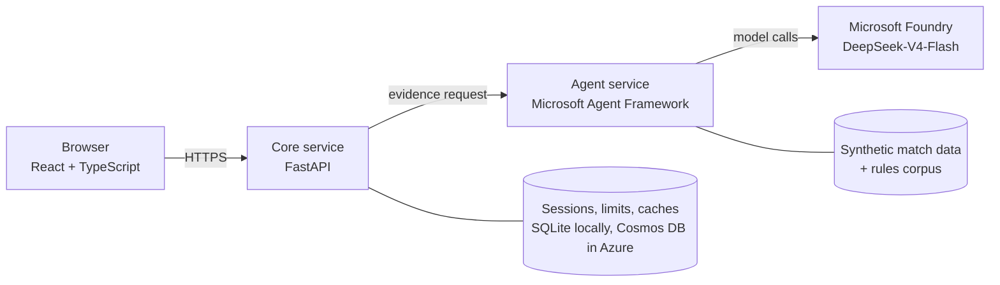

# Next Whistle

**A football match companion that explains what just happened, and why the referee made the call.**

Watch a fictional match replay in real time, tap any key moment, and get an explanation at your level (beginner, intermediate or pro) in your language. Ask the Ref about a decision, or about the Laws of the Game in general. Every number, measurement and rule citation comes from checked data, and a language model only does the explaining.

> All clubs, players, matches and tracking data are fictional and generated by this project. No broadcast footage, crests, player likenesses or scraped data are used.

## What you can do

- **Watch a live replay.** A shared match clock drives a pitch view with every player and the ball, a match feed, score and stats. Switch tactical overlays on (pressure, passing lanes, offside line) and follow up to three players.
- **Explain this moment.** Goals, cards, saves, substitutions and recaps are explained at three levels. Facts never change between levels; only the amount of detail and the wording do.
- **Ask the Ref.** Pick a recorded decision (offside, penalty, tactical foul) and ask why. The recorded ruling is always repeated exactly, with the Law cited and a call within measurement uncertainty reported as not settled.
- **Ask about the Laws.** Free-text questions such as "what is offside?" are answered from the project's own paraphrased rules corpus, in your language.
- **Replay key moments.** The match timeline marks goals, cards and decisions with icons; one click replays the moment on the main pitch.
- **No spoilers.** Everything shown, retrieved or generated is bound to the viewer's current match time, including decisions that are only confirmed later, such as a VAR review.

## How the AI works



1. The **Core** owns the public API: anonymous sessions, rate limits, a shared spend allowance, caches and a kill switch. It decides what the viewer may see at their current time.
2. The **Analyst / Referee** agent gathers evidence through cutoff-bound tools (match state, event evidence, decision geometry, rule references, stats) and writes a level-free evidence brief.
3. A **code validator** checks that brief: every number, name, minute and rule citation must come from a tool result, and nothing may come from after the viewer's cutoff.
4. The **Storyteller** agent turns the checked brief into an answer at the viewer's level and language. An optional **Critic** can review it.
5. A failed check is retried once, then the viewer gets a plain factual answer built from the data (English and Spanish), never an invented one.

Measurements and decision geometry are computed in deterministic code. The model never supplies a number, an event or a rule citation of its own.

## Run it locally

You need Python 3.12 and 3.13, [uv](https://docs.astral.sh/uv/), and Node 22.12 or newer. No Azure account or model access is needed for the default setup.

```bash
make setup      # install backend and frontend dependencies
make core       # terminal 1: Core API on http://127.0.0.1:8000
make agent      # terminal 2: Agent service on http://127.0.0.1:8088
make frontend   # terminal 3: UI on http://localhost:5173
```

By default the agent runs in `fake` mode: it makes **no model calls and costs nothing**, and answers come from deterministic scripted roles. To use a real model, set `AGENT_MODE=foundry` and the Foundry variables described in [backend/README.md](backend/README.md). That spends money, so it is off unless you turn it on.

```bash
make test             # Core and agent unit tests
make eval             # 116 golden Q&A cases on the scripted roles (free)
make build            # TypeScript check and production frontend build
make data             # regenerate the synthetic dataset (deterministic)
make validate-data    # validate hashes, chronology, cutoffs, geometry and movement limits
```

`make eval-live` runs the golden cases against real models and spends money; read [eval/README.md](eval/README.md) first.

## Tech stack

| Part | Technology |
| --- | --- |
| Frontend | React 18, TypeScript, Vite; original SVG pitch and icons |
| Core service | Python 3.12, FastAPI, Pydantic; SQLite locally, Azure Cosmos DB in production |
| Agent service | Python 3.13, Microsoft Agent Framework 1.x, Foundry Responses host |
| Model | DeepSeek-V4-Flash on Microsoft Foundry (pay per token) |
| Infrastructure | Bicep for Azure (Container Apps, Static Web Apps, Cosmos DB, Storage); Dockerfiles in `infra/docker/` |

## Repository layout

| Path | Contents |
| --- | --- |
| `frontend/` | React application ([asset register](frontend/ASSETS.md)) |
| `backend/services/core_application_service/` | Public API, sessions, limits, caches, agent client |
| `backend/services/agent_service/` | Agent workflow, evidence tools, prompts, model runner |
| `backend/shared/` | Contracts and deterministic evidence code used by both services |
| `data/` | Generators, validator, rules corpus and versioned datasets ([details](data/README.md), [sources](data/SOURCES.md)) |
| `eval/` | Golden question set and evaluation harness ([details](eval/README.md)) |
| `infra/` | Bicep templates, deploy and teardown scripts, Dockerfiles |
| `docs/` | [Architecture](docs/architecture.md), [build spec](docs/build-spec.md), [cloud plan](docs/cloud-plan.md), [costs](docs/costs.md) |

## Evidence and quality

- **Tests:** 111 Core tests and 57 agent tests pass, and the scripted evaluation passes 116 of 116 cases.
- **Live evaluation:** the same 116 cases were run against the real model (DeepSeek-V4-Flash): **110 passed (94.8%)**. That run used the previous dataset version, before the match generator was rebuilt, and has not been repeated since. A pass means the facts, citations, level limits and language are right.
- **Cost:** the whole evaluation effort cost well under one US dollar of model usage. The project's total cloud budget is USD 20 ([plan](docs/cloud-plan.md)).

## Known limitations

- A cold referee or recap answer can take 20 to 60 seconds. The UI shows a wait message and the services time out generously rather than fail.
- The validator checks facts, citations and format. It cannot catch every invented tactical or causal remark in the wording.
- Spanish is covered end to end for the stored fallback answers; the rules corpus itself is English, and other languages rely on the model.
- The frontend has no automated tests yet.
- The Azure deployment is prepared (templates, Dockerfiles, a deployment plan) but this repository does not link a live instance yet.

## Rules and licensing

Football rules are paraphrased in original wording and cited to the IFAB Laws of the Game; the Laws' text is not reproduced. Every external source is recorded in [data/SOURCES.md](data/SOURCES.md), and every visual asset in [frontend/ASSETS.md](frontend/ASSETS.md).

The code is released under the [MIT License](LICENSE). The match data, clubs and players are fictional.
