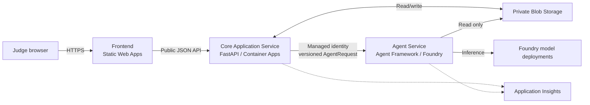

# Next Whistle Architecture Specification

**Status:** Approved development baseline  
**Version:** 1.0  
**Date:** October 22, 2026

## 1. Purpose and authority

This is the canonical technical architecture for development. It turns the product intent in the HLD and the detailed domain contracts in the LLD into deployable service boundaries. If an older planning document places the agent workflow inside FastAPI or describes one backend deployment, this document wins.

Next Whistle has **three independently built, versioned, deployed, and rolled-back units**:

1. React frontend on Azure Static Web Apps.
2. FastAPI Core Application Service on Azure Container Apps.
3. Microsoft Agent Framework Agent Service on Microsoft Foundry Hosted Agents.

The [cloud plan](cloud-plan.md) owns resource configuration, the USD 20 hard budget, expiration, and cleanup.

## 2. System context



Only the frontend and Core API are public application surfaces. The Foundry endpoint accepts the Core identity; browsers never call it directly.

## 3. Deployment units

### Frontend

The React/TypeScript application owns match selection, playback state, pitch rendering, overlays, settings, evidence navigation, and status messaging. It stores viewer preferences in the browser and treats every response as untrusted data. It never contains Azure credentials, calculates authoritative facts, or calls models.

The frontend is a client-rendered Vite single-page application. It uses React Router for the two routes, TanStack Query for server state, and Zustand for playback/viewer state. Keep feature code grouped by user capability rather than by generic component type:

```text
frontend/src/
  app/                 # router, providers, error boundary, application shell
  api/                 # fetch client, generated OpenAPI types, problem parsing
  routes/              # MatchPickerRoute, MatchRoute
  features/
    catalog/           # spoiler-free match selection
    replay/            # clock, state/delta loading, pitch, timeline, overlays
    narratives/        # automatic cards and evidence navigation
    explanations/      # explain/compare/recap requests and result slots
    referee/            # decisions, questions, answers, decision geometry
    settings/          # level, language, club and focus player
  components/          # truly shared UI primitives only
  i18n/                # reviewed UI strings
  styles/              # tokens, base styles and responsive layout
  test/                # test setup and reusable fixtures
```

The Core OpenAPI document is the source for public API types. Generate frontend transport types during development and fail CI when committed generated types are stale. Feature modules map transport objects into view models; generated files contain no application behavior.

#### Routes and URL state

| Route | Responsibility |
| --- | --- |
| `/` | Spoiler-free two-match catalog and initial viewer settings |
| `/match/:matchId` | Replay, pitch, timeline, panels, explanations, and Ask the Ref |

The match URL mirrors shareable state in query parameters: replay time, level, language, club, and focus player. Validate all URL values and fall back to safe defaults. Playing/paused state, open tabs, tokens, and pending requests are not shareable URL state.

#### State ownership

| State | Owner | Persistence |
| --- | --- | --- |
| Catalog, replay responses, cues, cards, decisions | TanStack Query | Memory only |
| Clock, speed, playing, selected tab/event, context epoch | Zustand | Memory; selected query values mirror to URL |
| Level, language, club, focus player | Settings feature | URL plus guarded `localStorage` |
| Anonymous session token | API client | `sessionStorage`; never local storage or URL |
| Explanation/referee result slots | Feature store keyed by context | Memory; cached server results still come from Core |

Do not duplicate server responses into the playback store. Query data remains immutable; selectors derive what is visible at the current clock.

#### Replay and request behavior

- `GET /api/live-state` binds all viewers to one wall-clock-driven match cycle. The response is never cached; the browser uses server time to correct local clock skew. Reloading later enters the current stage, while concurrent viewers share the same instance and cutoff.
- `requestAnimationFrame` advances the browser clock at 1× or 4× and stops at full time.
- The frontend fetches bounded replay deltas near `heldUntilMs` and immutable one-minute tracking chunks; it never sends a request per animation frame.
- Events, markers, cards, cues, and decisions render only when `availableMs <= clockMs`.
- Seeking pauses playback, increments `contextEpoch`, cancels obsolete queries, loads a full state snapshot, and optionally resumes.
- Generation results carry the request epoch and clock. Stale results never replace the active panel; they may remain as clearly labeled historical cards.
- Evidence navigation may seek backward to visible evidence. It must never reveal or seek forward to evidence beyond the current cutoff.
- Mutation buttons prevent duplicate submission and always send an idempotency key.

#### Presentation and accessibility

Desktop uses a pitch-and-panel layout; mobile stacks the pitch above panels with reachable playback controls. The SVG pitch uses a `105 × 68` view box. It interpolates supplied tracking keyframes for presentation but renders decision evidence only from explicit evidence geometry. Required feature surfaces are Match Picker, Score Bug, Pitch, Overlay Layer, Timeline, Moments, Stats, Player, Explain, Referee, Settings, and Status Banner.

All controls have accessible names and visible focus. Space toggles playback; arrow keys seek by five seconds. Pitch-only information has an equivalent text description. Respect `prefers-reduced-motion`, maintain WCAG AA contrast, avoid color-only status, and keep status/error updates in suitable live regions. UI strings live in reviewed locale files; generated content is displayed in the language reported by the response.

#### Frontend failure boundary

An application error boundary protects navigation and offers a reload path. API failures are parsed from problem+json and mapped to specific states: waking server, offline, rate limited, generation disabled, facts-only fallback, or retryable failure. GET requests may retry with a bounded backoff; generation mutations do not retry automatically. Replay and cached factual content remain usable when sessions, Agent Service, or model inference fail.

### Core Application Service

The Core Service is the public backend and the system of record for request control. It owns:

- FastAPI routes and RFC 9457 problem responses.
- Match catalog, replay state, statistics, overlays, narratives, and evidence APIs.
- Anonymous session tokens, input validation, CORS, rate limits, concurrency, and idempotency.
- Global model allowance, the generation kill switch, cache lookup/write, and factual fallback.
- Construction of immutable agent context and validation of Agent Service responses.
- Read/write Blob access and the managed-identity client for the Foundry endpoint.

The Core never owns prompts, agent roles, model credentials, or model tool loops.

### Agent Service

The Agent Service is one Foundry Hosted Agent deployed as a Python 3.13 source ZIP. It does not use FastAPI. Its `main.py` builds the workflow and starts `ResponsesHostServer` from `agent-framework-foundry-hosting`.

It owns:

- Microsoft Agent Framework workflow routing and handoffs.
- Analyst, Referee, Storyteller, and optional Critic roles.
- Versioned prompts, per-role tool allowlists, turn limits, and structured output.
- Evidence tool dispatch against immutable data.
- Evidence-brief and generated-answer validation.
- Agent and tool telemetry.

The Agent identity receives read-only access to dataset and rules containers. It cannot write cache, usage, or session records.

### Shared backend package

`backend/shared` contains Pydantic contracts and pure deterministic logic used by both services. It may depend on Pydantic and the standard library. It must not import FastAPI, Azure SDKs, Agent Framework, or either service package.

Both services may import Shared. They must never import each other.

## 4. Service contract

The logical transport contract is independent of the current Foundry SDK. The Core serializes `AgentRequest` through the hosted Responses protocol and parses `AgentResponse`. Both include `schemaVersion`.

`AgentRequest` contains:

- `requestId` and operation: `explain`, `compare`, `recap`, `decision`, or `refereeQuestion`.
- Bound context: match, selected event, dataset/rules versions, cutoff, evidence cutoff, and intent.
- Viewer settings: level, language, club perspective, and focus player.
- Optional approved question ID, bounded question text, and at most two prior answer headlines.
- Execution limits selected by the Core. Agent code may lower these limits but never raise them.

`AgentResponse` contains:

- Request and schema versions, status, source, and workflow version.
- Structured explanation, recap, or referee answer.
- Evidence IDs, statistic references, decision geometry, and uncertainty.
- Model/agent version metadata and measured token usage.
- A typed error when the workflow cannot produce a validated answer.

The Agent never returns HTML. The Core rejects an incompatible version, mismatched request ID/context, unknown evidence reference, or invalid schema and serves a cache/template fallback.

## 5. Request flow

1. The frontend sends a generation request and anonymous bearer token to the Core.
2. The Core validates the session, request, visibility cutoff, rate limit, idempotency key, and remaining allowance.
3. The Core returns a validated cache hit when available.
4. The Core reserves usage, creates an immutable `AgentRequest`, and invokes the pinned Foundry agent version.
5. The Agent routes to Analyst or Referee. Tool calls read only records visible at the bound cutoff.
6. A validated evidence brief passes to Storyteller; optional Critic may inspect the result. One routed retry is allowed.
7. The Agent returns structured output. The Core validates context and evidence again, settles usage, writes the cache, and shapes the public response.
8. Timeout, invalid output, exhausted allowance, or Foundry failure produces factual/cached output; replay remains available.

## 6. Data ownership

| Data | Owner | Access |
| --- | --- | --- |
| Versioned matches, snapshots, rules | Shared data pipeline | Core read; Agent read |
| Replay indexes | Each service process | Disposable memory |
| Explanation and brief caches | Core | Core read/write |
| Usage ledger and idempotency | Core | Core read/write |
| Anonymous session state | Core | Signed token plus bounded operational records |
| Prompts and workflow definitions | Agent Service | Packaged source |
| Viewer preferences | Frontend | Browser storage |
| Agent session state | Foundry runtime | Ephemeral; no application truth |

Every record obeys `available_ms <= cutoff_ms`. Personalization changes selection and wording, never facts.

## 7. Security and failure boundaries

- Use managed identity for Azure access and GitHub OIDC for deployment.
- Restrict CORS to deployed frontend origins.
- Give Core Blob write permission only where required; give Agent read-only evidence access.
- Bind match ID, versions, cutoff, intent, and tool allowlist in code. Model arguments cannot replace them.
- Treat referee free text as bounded data, not instructions.
- Render generated content as text; do not use `dangerouslySetInnerHTML`. Enforce a Static Web Apps content-security policy that permits connections only to the Core API and required same-origin assets.
- Do not log bearer tokens, signing keys, raw IPs, or secrets.
- Keep one retry boundary. Repeated failure returns deterministic output.
- Model and agent unavailability must not affect health readiness or factual replay.
- The USD 20 ceiling applies to the whole project. Core-side allowance controls stop paid generation before Azure budget alerts.

## 8. Observability

Propagate `requestId` and trace context across frontend, Core, Agent Service, tools, and Foundry inference. The frontend records route, operation, latency, response source, and sanitized failure code, plus browser errors needed to reproduce a broken judge path. Record cache source, workflow route, tool count, validation failures, retries, token use, and fallback reason on the backend. Never attach full tokens or unbounded user text.

A successful demo trace should show:

```text
Core request → cache → allowance reservation → Foundry invocation
→ Analyst/Referee → evidence tools → brief validation
→ Storyteller → answer validation → Core validation → cache → response
```

## 9. Independent releases

Each release records:

- Frontend build commit and Static Web Apps deployment.
- Core Git commit and immutable GHCR digest.
- Agent source commit, ZIP SHA-256, shared-contract version, and Foundry agent version.
- Dataset, rules, prompt, tool-schema, and validator versions.

A release can promote or roll back one unit only after contract tests prove compatibility with the other pinned versions. Agent source deployment avoids customer-managed ACR; the Core uses public GHCR. End-of-judging cleanup follows the guarded resource-group deletion in the cloud plan.

The frontend release gate includes TypeScript, lint, unit/component tests, production build, Static Web Apps configuration validation, and a Playwright smoke test against the pinned Core contract. The production bundle contains no source secrets, Azure IDs beyond public endpoints, development proxy settings, or source maps unless explicitly retained in a protected diagnostics destination.
